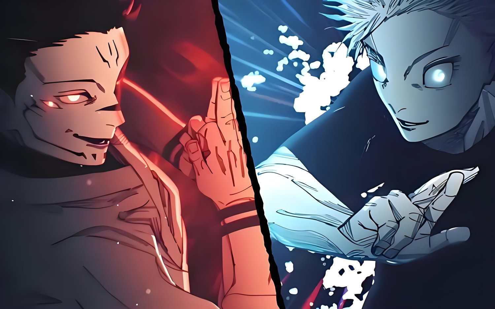

# 人外魔境 · 新宿决战

**五条悟 vs 宿傩。回合制，可以自己上手打。单个 HTML 文件 —— 打开就能打，断网也能打。**

[▶ 在线试玩](https://linziyang777.github.io/jjk-shinjuku-battle/)　·　[⤓ 下载单文件](https://github.com/linziyang777/jjk-shinjuku-battle/raw/main/index.html)　·　47 MB　·　零依赖

## 这是什么

《咒术回战》新宿决战的同人二创，做成能上手操作的对战。挑一名术师，轮流出招、格挡、攒咒力开领域，在 QTE 里赌一发黑闪。对面那位是宿傩。

六名可操作角色，招式、领域、语音各不相同。

## 参战角色

| 角色 | 术式 | 奥义 |
|---|---|---|
| 五条悟 | 术式顺转·苍 | 虚式·茈 |
| 鹿紫云一 | 术式顺转·放电 | 幻兽琥珀·解放 |
| 日车宽见 | 法槌·开庭 | 处刑人之剑 |
| 虎杖悠仁 | 迳庭拳 | 赤血操术·穿血 |
| 乙骨忧太 | 太刀·咒斩 | 领域·真赝相爱 |
| 真希 | 释魂刀 | 无声突袭 |

## 怎么玩

- 选角色 → 选难度 → 开打。出招、格挡、攒咒力，够了就开领域。
- **黑闪**：出招有 8% 概率触发（虎杖 14%），连续黑闪每次 +3%，最高 +15%。金色计量条点中时，该击伤害 ×2。
- **魔虚罗**：宿傩生命掉到 90% 以下之后会召唤出来。
- 电脑端 **空格** = 暂停 / 继续（只在战斗阶段生效）。
- 手机端自动适配横屏比例，竖屏会转过来铺满。

## 技术说明

- 一个 HTML 文件：结构、样式、逻辑全在里面。
- 12 张 PNG、43 张 WebP、3 张 JPEG、11 段 MP3、1 段开场 MP4，全部 base64 内嵌。**运行时没有一次外部请求。**
- 无框架、无构建工具、无 CDN、无字体外链。
- 代价是 **47 MB**：第一次打开要等它整个下完。换来的是一份文件拷走就能跑，断网照玩。
- 托管在 GitHub Pages。

## 本地打开

下载 [index.html](https://github.com/linziyang777/jjk-shinjuku-battle/raw/main/index.html)，双击。不需要服务器，不需要联网。

## 同人声明

非商业同人作品。角色、世界观与原作设定版权归芥见下々 / 集英社所有。本项目仅供学习与技术交流，不用于任何商业用途。如有侵权请联系删除。

## 更新记录

版本已经迭代到 **v221**。挑几条大的：

- `v160` 开场影片 + 落地页重做
- `v174` 开场影片声音修复，处理浏览器自动播放拦截
- `v179` 战斗规则文案勘误，全部对齐代码实际结算
- `v180` 登场动画提速，去掉多余徽章
- `v181` 特效重做：「捌」赤红针芒、「解」墨痕刮过、虎杖「灵魂·解」

---

觉得有意思的话，点个 star 就好。
